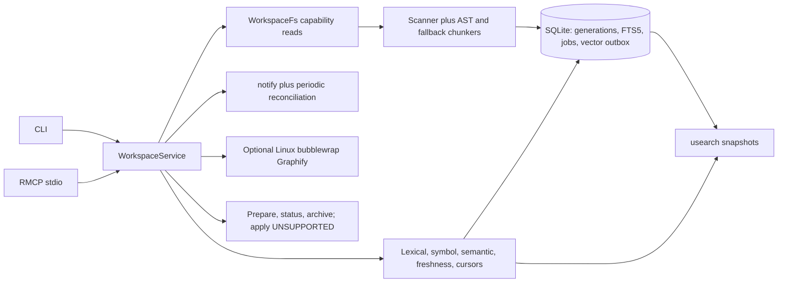

# Architecture

`workspace-index-mcp` is a standalone Rust package providing a CLI and MCP stdio server over one shared `WorkspaceService`. It indexes explicitly registered local roots; it is not a cloud service, does not auto-register arbitrary directories, and does not claim proprietary Augment parity.

## Component map

- `src/main.rs` parses CLI operations and resolves config/state paths. `src/mcp/server.rs` serves MCP tools, resources, subscriptions, and prompt routes using the static tool/approval registry in `src/tool_registry.rs`.
- `src/service.rs` is the shared orchestration layer. It owns the state connection, provider/profile coordination, per-root coordination, cursor state, and the exclusive owner lock.
- `src/index/` implements ignore-aware scanning, parser/chunk conversion, embedding, reconciliation, vector sequencing, semantic snapshots, and Graphify. `src/watch/` observes filesystem/Git changes, builds capability-read manifests, and queues reconciliation.
- `src/retrieval/` fuses eligible lexical, symbol, and semantic candidates, validates current source content through `WorkspaceFs`, and manages generation/profile-bound cursors. `src/security/` contains registered-root path resolution and file reads. `src/changeset.rs` prepares diffs and records intended changes; it does not currently perform source effects.

## Durable state and indexing flow

SQLite at `index.db` is authoritative. WAL, foreign keys, and `synchronous=FULL` are enabled. Append-only schema migrations currently run from v1 through v10. The schema stores workspace identity and Git markers, file/chunk/parser metadata, FTS data, symbols and dependency evidence, embedding profiles and vectors, index generations/health, profile watermarks, stable numeric vector IDs, vector-operation outbox records, reconciliation jobs, changeset/audit journals, and unregistered-changeset archives. `vectors/` contains derived usearch state and can be rebuilt from SQLite; `pending/` holds active private prepared-change payloads. Archive and cleanup-queue rows have no workspace/pending foreign keys, so they survive unregister cascades; archive JSON contains status, hashes, relative paths, and audit events, never source text. Cleanup rows persist a canonical recovery target before malformed-ID orphan unlink so retries survive sync/row-delete failure. Optional graph snapshots live in private `graphs/` storage.

Reconciliation scans the registered root using ignore rules and reads source only through `WorkspaceFs`. Supported source text is parsed/chunked and optionally embedded. Successful file/index results are committed to SQLite; vector operations are durably enqueued and applied to profile/generation-specific usearch snapshots. A generation becomes visible after reconciliation publication. Semantic results are only served when profile and applied-generation coverage match the visible state; otherwise lexical/symbol search can return with a degraded warning.

Filesystem watchers coalesce changes into durable work; periodic manifests repair missed events. Child-directory create/remove and rename events request a full reconciliation, while watched-root notification paths are ignored to avoid self-triggered full scans. Git branch/HEAD transitions gate results from the old visible generation until a replacement is published. Search checks candidate freshness through the capability boundary, excludes stale content, queues stale paths, and can refresh at most three paths before one retry within a ten-second deadline. One tracked refresh/retry worker is allowed per service; timed-out synchronous filesystem/provider work may continue, and new refresh work is refused until that worker exits. Search continuation uses authenticated cursors over a bounded, frozen in-process result set; cursor invalidation on changed generation/profile, restart, expiry, or eviction is reported as `STALE_CURSOR`.

## Security and effect boundary

Registration is explicit and binds an ID to a canonical root and filesystem identity. Git roots are required unless the explicit non-Git option is enabled; that option changes repository policy, not filesystem containment. `WorkspaceFs` validates relative paths, rejects traversal and symlink components, opens directories without following symlinks, checks registered root/parent identities, and performs bounded reads through opened handles. Scanner, watcher/reconciliation manifests, retrieval freshness checks, and user-facing file reads all use this capability path; scan/read errors are not treated as evidence that files were deleted.

Embeddings are local by default. Remote Ollama/OpenAI-compatible calls require `allow_remote = true`, including local HTTP endpoints, and send query/chunk text to the configured endpoint. Credentials are sourced by environment-variable name. They are not part of source write policy.

Graphify is opt-in and separate from ordinary indexing/search. In this build, extraction runs only on Linux under bubblewrap with private, bounded staging/output and an explicit code-only invocation. Extraction returns an unpublished snapshot; final publication/pruning rechecks generation, registration epoch, and root identity under the per-root lock. Storage paths, cache entries, and cursors are registration-bound; source hashes are revalidated through WorkspaceFs before reads. Failed current-generation extraction returns no nodes. No working sandbox means fail closed with `GRAPH_UNAVAILABLE`; Graphify cannot enable source writes.

Changeset preparation validates paths and preconditions, persists a private payload, and returns an approval diff without modifying source. Unregister takes the same per-root lock as prepare/apply, then atomically archives each changeset, records exact operation-ID payload cleanup, advances the registration tombstone, and deletes the workspace. After commit, payload unlink and pending-directory sync are attempted; failures remain queued and are retried at startup and by `doctor`. Archived status remains readable with per-file paths/hashes/states and audit evidence, while apply/discard are refused. The archive contains no proposed/base source text. `changeset_apply` is the only source-effect route in the tool registry, is prompt-gated by omp policy, and currently returns `UNSUPPORTED` before claiming or performing any effect. This is intentional: available final directory-entry operations cannot prove containment against concurrent parent relocation. **Source mutations are disabled on all platforms.** `read_write` is not evidence of an enabled or safe mutation backend. Multi-file changesets are not atomic.

## Ownership and lifecycle

A process opening state acquires an exclusive lifetime lock for the data directory; a second owner fails with `BUSY`. This prevents separate CLI/server processes from concurrently owning SQLite, watcher, and vector state. State commands are therefore performed through the live MCP session or after its owner exits.

Watcher stop waits at most two seconds. Still-running watcher handles remain in a process-wide registry capped at 128; another watcher cannot start for that root until its worker exits. MCP unregister returns `BUSY` and keeps the workspace registered if its watcher misses the stop bound. Server shutdown signals remaining watchers with a shared two-second bound. Every watcher loop exit queues a durable full reconciliation before releasing its backend, even if its local queue appears clean; failure leaves watcher status dirty and records the queue error. Synchronous filesystem/provider calls cannot be forcibly cancelled; timed-out workers remain tracked and may retain the service owner lock until completion. The full-reconcile handoff covers late notify callbacks racing teardown.

## Operational limitations and evidence

- Source writes and apply are disabled on all platforms; macOS mutation proof is unavailable.
- The `WorkspaceFs` code supports Linux/macOS registered-root reads; Linux was exercised here, while macOS runtime behavior is unverified. Other platforms fail closed.
- The README benchmark ledger records the valid 250,000-chunk/10-workspace baseline and three 100-sample post-FTS runs; each final p95 was below the local 750ms synthetic target. Retrieval-quality qrels remain unverified, and the synthetic result is not a production performance guarantee.
- Malformed-payload orphan recovery is bounded to 10,000 pending-directory entries; overflow or ambiguous references remain queued and visible in `doctor`. Handle-relative directory operations do not defend against a same-UID process racing an entry replacement.
- Actual omp interactive approval E2E is unverified. Isolated temporary-HOME installer/check behavior was exercised; the user's actual default OMP config was not modified. Tool approval cannot enable currently disabled source effects.
- The ignored FastEmbed local model smoke requires downloading/loading the model. A previous run passed 1/1 in 10.12s; this is not a no-network smoke test.
- Full `cargo test --workspace` passed 263 tests across 17 suites with one ignored after request-bound cursor fixes. Strict Clippy passed after the v9 cleanup, graph-isolation, cursor, TTL, v10 index, semantic mapping, and watcher recovery changes. Final release build/install and minimal-PATH CLI smoke passed. Linux bubblewrap Graphify smoke passed 16/16, including the installed Graphify CLI.

These observations are not a declaration of full release readiness. See [README.md](README.md) for supported commands, configuration, omp setup, and the exact verification commands.
